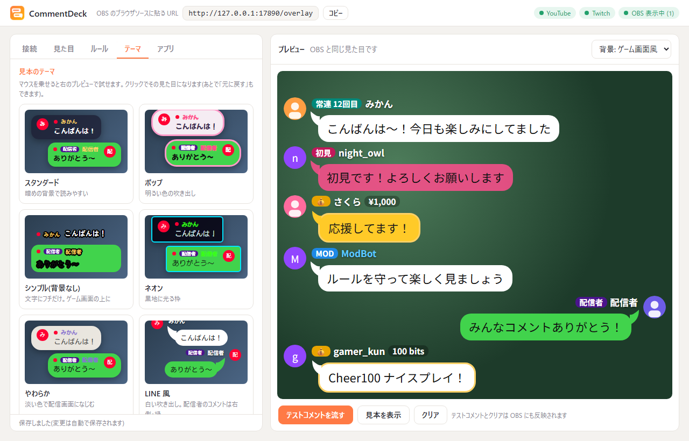
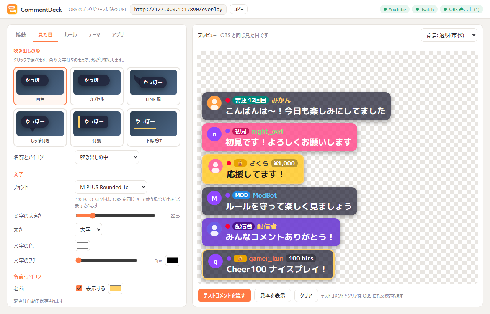
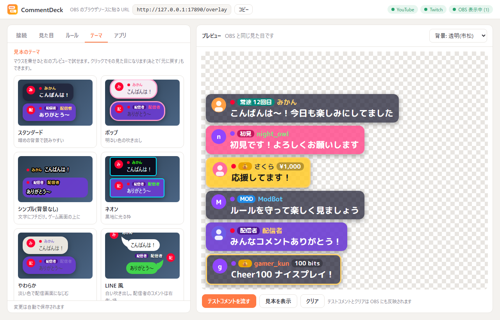
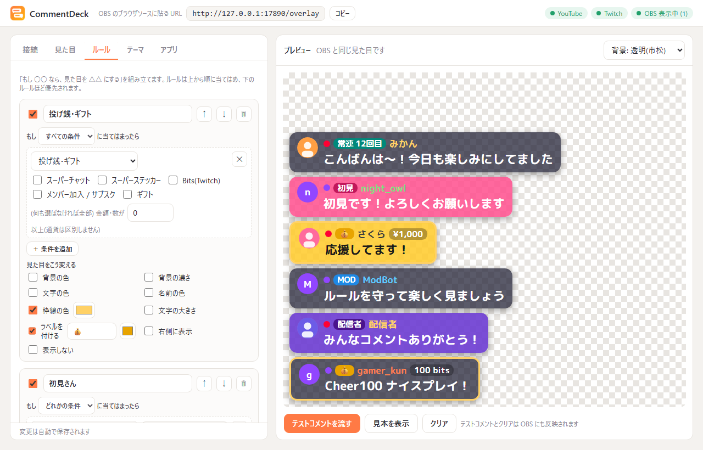

# CommentDeck(配信用コメント表示ツール)

YouTube / Twitch のコメントを、OBS の配信画面に**自由な見た目で**表示する Windows アプリです。
吹き出しの形・フォント・色を画面で選ぶだけで変えられ、「初見さん」「常連さん」「投げ銭」などで見た目を変えるルールも作れます。



## できること

### コメントの表示
- **YouTube と Twitch のコメントを同時に表示**
  - YouTube: チャンネル(@ハンドル)から配信中の枠を自動で見つけます。限定公開の配信は「配信の URL」に切り替えて接続
  - Twitch: チャンネル名を入れるだけ(ログイン不要)
- OBS の「ブラウザ」ソースに URL を貼るだけで表示。見た目の変更はプレビューと OBS にすぐ反映されます

### 見た目のカスタマイズ



- **吹き出しの形を絵で選べる**: 四角 / カプセル / LINE 風 / しっぽ付き / 付箋 / 下線だけ
- 名前とアイコンを吹き出しの中に入れるか、外に出すか(LINE 風)
- フォント(Google Fonts / PC のフォント)、文字の大きさ・太さ・色・フチ、背景・枠線・角の丸み・余白
- 並べ方(下から / 上から)、寄せる位置、表示件数、自動で消す時間、出てくるときの動き
- 作った見た目はファイルに書き出して共有できます

### テーマ



- **テーマ 10 種類**: スタンダード / ポップ / シンプル(背景なし)/ ネオン / やわらか / LINE 風 / しっぽ付き吹き出し / カプセル / 付箋 / テロップ(下線)
- マウスを乗せると右のプレビューで試せて、クリックで反映。「元に戻す」で直前の見た目に戻せます

### 条件で見た目を変えるルール



「もし ○○ なら、見た目を △△ にする」を、画面で選ぶだけで組み立てられます。

| 条件 | 例 |
| --- | --- |
| 特定の文字を含む | 「初見」「草」を含むコメント |
| コメントした人の種類 | 配信者 / モデレーター / メンバーシップ(YouTube)・サブスク(Twitch)/ VIP / 初見(チャンネルで初めて) |
| 常連さん | コメントした配信が ○ 回以上 |
| 投げ銭・ギフト | スーパーチャット・Bits・ギフトなど(金額以上) |
| 特定のユーザー / 配信サービス | 決まった人だけ、YouTube だけ など |

変えられる内容: 背景色・文字色・名前の色・枠線・文字の大きさ・ラベル(「初見」「常連 12回目」など)・右側に表示・表示しない(NG ワード)

> 「初見」(YouTube)と「常連さん」は、CommentDeck がコメントした人と来てくれた回数(コメントした配信の数)を記録して判定します。
> 使い始めてから数えるので、効いてくるのは何回か配信してからです。

### そのほか
- フォントによって表示できない記号(「〜」など)を自動で見た目の近い文字に置き換え
- 「クリア」でプレビューと OBS の表示をまとめて消去
- **自動アップデート**(署名を検証した更新だけを適用)

## 使い方

1. [Releases](../../releases/latest) から `CommentDeck_x.y.z_x64-setup.exe` をダウンロードしてインストール
2. 「接続」タブで YouTube のチャンネル / Twitch のチャンネル名を入れて「接続」
3. 画面上の URL を「コピー」し、OBS の「ソース」→「ブラウザ」に貼り付け(例: 幅 600 × 高さ 900)
4. 「見た目」「ルール」「テーマ」タブで好きな見た目に。変更は自動で保存され、OBS にもすぐ反映されます

- 動作環境: Windows 10 / 11
- コード署名証明書は付けていないため、初回のインストール時に「WindowsによってPCが保護されました」と出ます。「詳細情報」→「実行」で進めてください(アプリ内の自動アップデートでは表示されません)
- **アップデートしたあとは、OBS のブラウザソースを一度だけ「更新」**してください(新しい見た目の描画が読み込まれます)

### 記録の保存場所と通信について

「初見」「常連さん」の記録や設定は、**この PC の中だけ**に保存されます。外部のサーバーに送ることはありません。

| 内容 | 保存場所 |
| --- | --- |
| 設定(見た目・ルール・接続先) | `%APPDATA%\com.linn0412.commentdeck\config.json` |
| 初見・常連さんの記録 | `%APPDATA%\com.linn0412.commentdeck\seen\`(チャンネルごとに 1 ファイル) |

- 記録しているのは、コメントした人の ID(YouTube のチャンネル ID / Twitch のユーザー ID)と、コメントした配信の数・コメント数・最後に来た配信だけです。コメントの本文は保存しません
- 記録はアプリの「アプリ」タブ →「記録を消す」でいつでも消せます(エクスプローラーのアドレス欄に `%APPDATA%\com.linn0412.commentdeck` と入れると、フォルダを直接開けます)
- アンインストールしても記録と設定は残ります。完全に消したいときは、上のフォルダを削除してください
- CommentDeck が通信するのは、コメントの読み込み(YouTube / Twitch)、アップデートの確認(GitHub)、OBS 側のフォントの読み込み(Google Fonts)だけです

### YouTube のコメントについて

YouTube の公式 API は 1 日の利用上限が厳しいため、多くのコメントビューアと同じく、
YouTube のチャット画面と同じ仕組みでコメントを読み込んでいます。YouTube の仕様変更で一時的に表示できなくなることがあります。
メンバー限定の配信には対応していません。

## 開発

- Tauri v2(Rust)+ HTML / JavaScript
- `ui/shared/render.js` がコメントの描画とルールの判定を担当し、設定画面のプレビューと OBS 用ページ(`/overlay`)の両方で使います
- アプリは `127.0.0.1:17890` で OBS 用ページと WebSocket(`/ws`)を提供します

```
npm install
npm run dev        # 開発用に起動
npm test           # ルール判定のテスト
cargo test --manifest-path src-tauri/Cargo.toml
```

`v*` のタグを push すると GitHub Actions がインストーラーと更新用の `latest.json` を作って Releases に公開します
(Secrets: `TAURI_SIGNING_PRIVATE_KEY` / `TAURI_SIGNING_PRIVATE_KEY_PASSWORD`)。アイコンは `tools/make-icon.ps1` で生成しています。

## ライセンス

[GNU General Public License v3.0](LICENSE)(GPL-3.0)

v0.1.5 までは MIT License で公開していました。次のバージョンから GPL-3.0 になります。
